# PATHFINDER
> *"Think. Navigate. Conquer."*

An educational tactical maze game in Python that teaches **Dijkstra's shortest path algorithm** through intuitive, hands-on gameplay. Built with Pygame, clean Object-Oriented Architecture, procedural audio synthesis, cut-vertex checkpoint gates, optional RAG-powered study material ingestion, and strict offline-first operation.

---

## Table of Contents

- [Key Gameplay Mechanics](#key-gameplay-mechanics--educational-rules)
- [Dijkstra's Algorithm — How It Works](#dijkstras-algorithm--how-it-works)
- [RAG Document Ingestion](#rag-document-ingestion-optional)
- [Visual Direction](#visual-direction--aesthetics)
- [Project Structure](#project-structure)
- [Installation & Running](#installation--running)
- [Controls](#controls)
- [Architecture Diagram](#architecture-diagram)

---

## Key Gameplay Mechanics & Educational Rules

1. **Shortest Steps ≠ Lowest Cost:**
   In weighted graphs, the fewest number of steps (BFS) is often far more expensive than a tactical detour around high-resistance terrain.
2. **Cost Rule:**
   - The starting coordinate is **free** (0 cost).
   - Traversal cost is paid strictly upon **entering** each subsequent tile according to its terrain weight:
     - **Open Corridor (Circle):** Cost `1`
     - **Sand Dune (Triangle):** Cost `2`
     - **Dense Woods (Diamond):** Cost `3`
     - **Deep Mire (Star):** Cost `5`
     - **Wall Barrier (Square):** Impassable
3. **Tile Grid:** The maze is `2 × rooms + 1` tiles wide/tall (walls occupy tiles, not edges).
4. **Telemetry & Efficiency:**
   - **Route Cost:** Player's cumulative movement cost.
   - **Optimal Cost:** The theoretical minimum cost determined by Dijkstra's algorithm.
   - **Efficiency:** `min(100, Optimal Cost / Player Cost × 100)%`.
     - `≥ 90%`: Success (Emerald `#35D39A`)
     - `60% – 89%`: Warning (Amber `#FFBF69`)
     - `< 60%`: Danger (Coral `#FF647C`)
5. **Checkpoint Gates:** Cut-vertex positions on the optimal route that **cannot be bypassed** — answer a quiz question to unlock. Wrong answers add cost penalties and deduct score.
6. **Levels:**
   | Level | Rooms | Checkpoints | Difficulty |
   |-------|-------|-------------|------------|
   | L1 — Sector Alpha | 7×7 | 1 | Easy |
   | L2 — Sector Beta | 9×9 | 2 | Easy |
   | L3 — Sector Gamma | 11×11 | 2 | Medium |
   | L4 — Sector Delta | 13×13 | 3 | Medium |
   | L5 — Sector Omega | 15×15 | 4 | Hard |

---

## Dijkstra's Algorithm — How It Works

Dijkstra's algorithm finds the shortest (least-cost) path from a source node to every other node in a weighted graph with non-negative edge weights.

### Core Idea

1. Maintain a **priority queue** (min-heap) of `(cost, node)`.
2. Start with `(0, source)`. All other distances are ∞.
3. Pop the node with the smallest cost. For each neighbour, if `current_cost + edge_weight < known_cost`, relax it.
4. Repeat until the destination is popped or the queue is empty.

### Complexity

| Metric | With Binary Heap |
|--------|-----------------|
| **Time** | O((V + E) log V) |
| **Space** | O(V) |

Where *V* = number of vertices (non-wall tiles) and *E* = number of edges (adjacencies between non-wall tiles). The `log V` factor comes from heap insertion and extraction.

### Implementation in PATHFINDER

`DijkstraSolver.solve(grid, start, end)` returns a tuple of `(path, cost, explored_order)`:
- **path**: List of `(x, y)` coordinates from start to end (inclusive).
- **cost**: The minimum total traversal cost (start is free; cost is paid on entering each cell).
- **explored_order**: Every cell popped from the priority queue, in order — used by the wavefront visualizer.

The solver is **stateless** with zero Pygame imports, making it fully unit-testable.

---

## RAG Document Ingestion (Optional)

PATHFINDER includes a fully optional **Retrieval-Augmented Generation** pipeline for turning your own study notes into checkpoint quiz questions.

### How It Works

1. **Ingest** TXT, Markdown, or PDF files (PDF requires `pypdf`).
2. **Chunk** text using a sliding word-window (configurable `chunk_size` and `chunk_overlap`).
3. **Retrieve** relevant chunks using **BM25 keyword search** (pure Python, zero dependencies).
4. **Generate** fill-in-the-blank cloze questions from key terms in the chunks.
5. **Validate** each question: grounding check, 4 unique options, answer present in source chunk.

### Optional Semantic Upgrade

Install `sentence-transformers` and `faiss-cpu` for dense vector search (cosine similarity) alongside BM25:

```bash
pip install -r requirements-rag.txt
```

The system **honestly labels** its retrieval mode: "keyword search" by default, "semantic search" only when the models are actually loaded.

### Optional LLM Generation

Set `OPENAI_API_KEY` or `ANTHROPIC_API_KEY` as environment variables. The pipeline will call the LLM API to generate higher-quality grounded questions. If no key is set, it falls back silently to the offline cloze generator.

> **Security:** API keys are read only from environment variables, never stored on disk or logged.

---

## Visual Direction & Aesthetics

- **Futuristic Dark-Navy Navigation Console:**
  - Background: `#0B1020`
  - Panels: `#141C2F`
  - Primary Accent: `#38D9FF` (Optimal Dijkstra path, player beacon)
  - Secondary Accent: `#8B7CFF` (Alternative route, subtitles)
  - Success: `#35D39A` (Destination beacon, peak efficiency)
  - Warning: `#FFBF69` (Mid-tier friction, moderate efficiency)
  - Danger: `#FF647C` (Severe hazard, low efficiency)
  - Text: `#F3F6FC`
- **Procedural Graphics:**
  - Layered alpha circles create pulsating glowing beacons on the player and destination.
  - Mathematical shape glyphs (circle, triangle, diamond, star, square, hexagon) rendered via geometry — zero Unicode font dependency.
  - Breadcrumb route trail tracks player exploration in real time.
- **Procedural Audio:**
  - All sound effects are synthesized in-memory using Python's built-in `math` and `array` modules — zero external audio files.
  - Movement ticks, checkpoint alerts, correct/wrong chimes, victory fanfare, and UI clicks.
  - Graceful silent degradation in headless/CI environments.
- **Screen Transitions:**
  - Smooth fade-out / fade-in overlays between screen states for polished UX.

---

## Project Structure

```
pathfinder/
├── main.py                         # Primary game entry point
├── requirements.txt                # Core dependencies (pygame, pytest)
├── requirements-rag.txt            # Optional RAG dependencies (pypdf, sentence-transformers, faiss-cpu)
├── pytest.ini                      # Pytest configuration
├── README.md                       # Complete documentation
├── config/
│   └── game_config.json            # Palette, window, levels, checkpoints, rewards, RAG settings
├── data/
│   ├── questions.json              # 56 verified quiz questions across 7+ topics
│   └── sample_study_material.md    # Sample study notes for testing RAG
├── src/
│   ├── __init__.py
│   ├── game.py                     # Core Game class: state machine, input, rendering
│   ├── grid.py                     # Grid, Cell, CellType, adjacency (get_neighbors)
│   ├── dijkstra_solver.py          # Dijkstra algorithm (heapq) and alternative bypass finder
│   ├── maze_generator.py           # Iterative DFS carver, loop creator, BFS validation
│   ├── path_visualizer.py          # Non-blocking wavefront animator & path drawer
│   ├── player.py                   # Player entity, movement, trail, efficiency
│   ├── ui_manager.py               # Console panels, buttons, procedural glyphs, progress bars
│   ├── level_manager.py            # Config-driven level progression (2*rooms+1)
│   ├── checkpoint.py               # Cut-vertex checkpoint placement & bypass-prevention
│   ├── question.py                 # Question bank with anti-repetition & topic fallback
│   ├── reward_manager.py           # Multi-category scoring with non-negative guarantee
│   ├── hint_system.py              # Path hints & 50/50 quiz elimination hints
│   ├── save_manager.py             # JSON save/load with corruption recovery
│   ├── timer.py                    # Non-blocking delta-time countdown timer
│   ├── sound_manager.py            # Procedural audio synthesis (zero external assets)
│   └── rag/
│       ├── __init__.py
│       ├── document_ingestor.py    # TXT/MD/PDF ingestion, sliding word-window chunking
│       ├── retriever.py            # BM25 keyword search + optional FAISS semantic search
│       ├── question_generator.py   # Cloze generator, LLM generator, QuestionValidator
│       └── pipeline.py             # RAGPipeline coordinator with telemetry
└── tests/
    ├── __init__.py
    ├── test_core.py                # Core algorithm tests
    ├── test_dijkstra.py            # Dijkstra solver: open grid, walls, weighted, 200+ random grids
    ├── test_maze_generator.py      # Maze: solvability, corners, loops, sizes 7–15
    ├── test_game_logic.py          # Movement, cost accumulation, efficiency edge cases
    ├── test_game_integration.py    # Headless integration & state machine test
    ├── test_checkpoints.py         # Cut-vertex placement, bypass prevention, question bank
    ├── test_progression_and_save.py # Level config, rewards, hints, saves, topic fallback
    └── test_rag.py                 # Document ingestion, retrieval, validation, LLM mocking
```

---

## Installation & Running

### 1. Requirements
- Python 3.9+ (Tested on Python 3.13)
- Pygame >= 2.5.0
- Pytest >= 7.0.0

### 2. Install Dependencies
```bash
pip install -r requirements.txt
```

For optional RAG document ingestion with semantic search:
```bash
pip install -r requirements-rag.txt
```

### 3. Run the Game
```bash
python main.py
```

### 4. Run Automated Tests
```bash
python -m pytest -v tests/
```

---

## Controls

| Key / Action | Function |
|---|---|
| **W / A / S / D** or **Arrow Keys** | Move player in 4 cardinal directions |
| **P** or **[Show Path]** button | Toggle Dijkstra wavefront exploration animation & optimal route |
| **H** or **[Hint]** button | Reveal next optimal step (costs score) |
| **R** or **[New Maze]** button | Regenerate a new validated procedural maze |
| **1 / 2 / 3 / 4** or **A / B / C / D** | Select quiz option during checkpoint overlay |
| **Enter / Space** | Confirm / Submit / Start Mission |
| **Esc** | Return to Main Menu / Exit |

---

## Architecture Diagram

```mermaid
classDiagram
    direction TB

    class Game {
        +run()
        +handle_events()
        +update(dt)
        +render()
    }

    class Grid {
        +width, height
        +get_cell(x, y)
        +get_neighbors(x, y)
    }

    class DijkstraSolver {
        +solve(grid, start, end)$
        +find_alternative(grid, start, end, path)$
    }

    class MazeGenerator {
        +generate(rooms_x, rooms_y)
    }

    class Player {
        +pos, total_cost
        +move(dx, dy, grid)
        +calculate_efficiency(optimal)
    }

    class LevelManager {
        +current_level, score
        +get_rooms()
        +get_checkpoints_count()
        +advance()
    }

    class CheckpointManager {
        +checkpoints
        +generate_checkpoints(grid, start, end, path, count)
        +validate_unbypassable(grid, start, end, pos)
    }

    class QuestionManager {
        +get_question(topic, difficulty)
        +add_custom_questions(questions)
        +get_topics()
    }

    class RewardManager {
        +calculate_level_rewards(...)
    }

    class HintManager {
        +request_path_hint(...)
        +request_quiz_hint(...)
    }

    class SaveManager {
        +save()
        +load()
        +has_saved_game()
    }

    class SoundManager {
        +play(sound_name)
    }

    class RAGPipeline {
        +process_file(path)
        +generated_questions
    }

    class PathVisualizer {
        +update(dt)
        +draw(surface, ...)
    }

    class UIManager {
        +draw_panel(...)
        +draw_button(...)
        +draw_glow_circle(...)
    }

    Game --> Grid
    Game --> DijkstraSolver
    Game --> MazeGenerator
    Game --> Player
    Game --> LevelManager
    Game --> CheckpointManager
    Game --> QuestionManager
    Game --> RewardManager
    Game --> HintManager
    Game --> SaveManager
    Game --> SoundManager
    Game --> RAGPipeline
    Game --> PathVisualizer
    Game --> UIManager
    CheckpointManager --> DijkstraSolver
    CheckpointManager --> QuestionManager
    RAGPipeline --> QuestionManager
```



---

## License

Educational project. All rights reserved.
"# akashat" 
