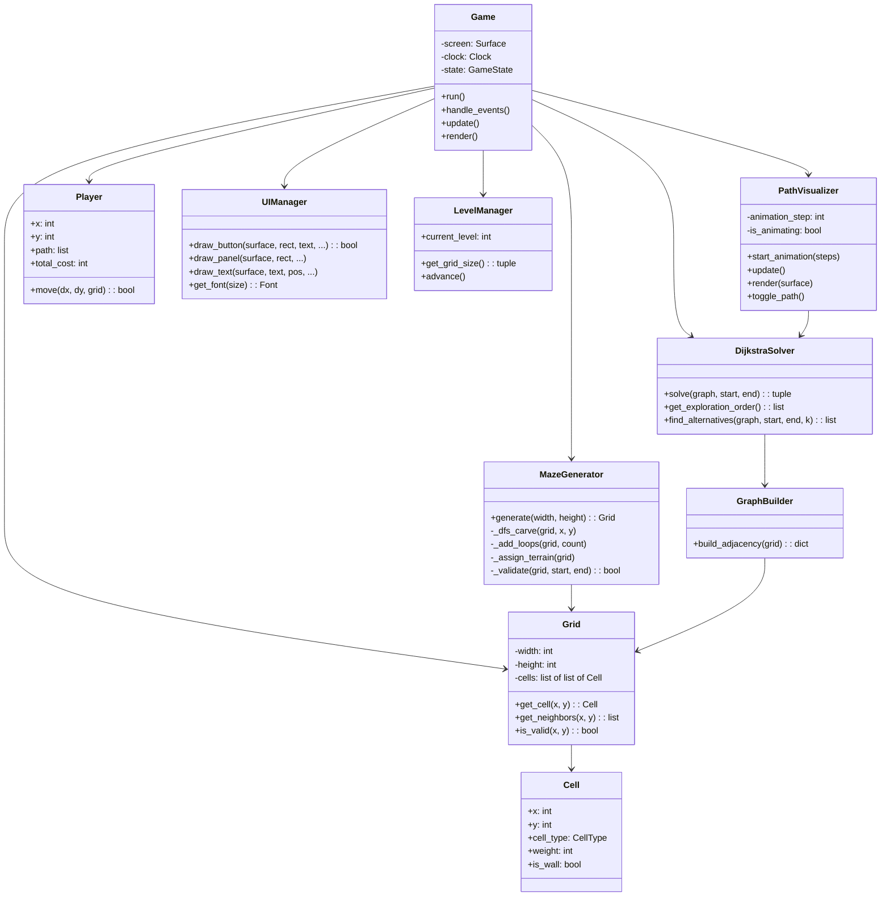

# PATHFINDER — Round 1 Plan
> *"Think. Navigate. Conquer."*

## Visual Direction

Dark navy futuristic navigation console. The maze is always the visual hero — everything else supports it.

| Token | Hex | Usage |
|---|---|---|
| Background | `#0B1020` | Window fill |
| Panel | `#141C2F` | Side panel, top bar, overlays |
| Primary | `#38D9FF` | Optimal path, active UI, player glow |
| Secondary | `#8B7CFF` | Alternative paths, hover states |
| Success | `#35D39A` | Destination, efficiency ≥ 100% |
| Warning | `#FFBF69` | Medium-weight terrain, mid-efficiency |
| Danger | `#FF647C` | High-weight terrain, low efficiency |
| Text | `#F3F6FC` | All text |

Subtle glows via layered alpha circles. Clean 4-8 px spacing. No heavy borders — use luminosity contrast.

---

## Screen Layouts

### Main Menu
```
┌──────────────────────────────────────┐
│          PATHFINDER (logo)           │
│      "Think. Navigate. Conquer."     │
│                                      │
│          [ ▶ Play ]                  │
│          [ ? How to Play ]           │
│          [ ⚙ Settings ] (stub)       │
│          [ ✕ Quit ]                  │
│                                      │
│   v0.1 · Round 1                     │
└──────────────────────────────────────┘
```

### Gameplay
```
┌─ Top Bar ────────────────────────────┐
│ Level 1    Score: 0     PATHFINDER   │
├──────────────────────┬───────────────┤
│                      │  Route Cost   │
│                      │  Optimal Cost │
│      M A Z E         │  Efficiency   │
│      (focus)         │               │
│                      │  Legend        │
│                      │  ────────────  │
│                      │  ■ Wall       │
│                      │  ○ Open (1)   │
│                      │  △ Sand (2)   │
│                      │  ◇ Forest (3) │
│                      │  ☆ Swamp (5)  │
│                      │               │
│                      │  [Show Path]  │
│                      │  [New Maze]   │
├──────────────────────┴───────────────┤
│ Arrow keys / WASD to move            │
└──────────────────────────────────────┘
```

### Checkpoint Overlay & Level Complete *(Round 2+)*
Modal over the gameplay screen. Not built yet.

---

## Class Diagram



### Interaction Notes
- **Game** owns the main loop and delegates to subsystems. State enum (`MENU`, `PLAYING`, `HOW_TO_PLAY`) drives which `update`/`render` path runs.
- **MazeGenerator** produces a **Grid** of **Cells**. **GraphBuilder** converts it into an adjacency dict for the solver.
- **DijkstraSolver** is pure algorithm — no Pygame dependency. It records exploration order so **PathVisualizer** can animate it.
- **Player** tracks position + trail. Movement validation goes through **Grid**.
- **UIManager** is a stateless drawing helper. No widget tree — just functions.
- **LevelManager** maps level numbers to grid sizes. Round 1: level 1 = 7×7.
- Classes not built in Round 1 (Checkpoint, Question, QuestionManager, RAGEngine, Timer, RewardManager, SaveManager) are listed in the full design but not instantiated.

---

## Project Structure

```
pathfinder/
├── main.py                  # Entry point
├── requirements.txt
├── README.md
├── config/
│   └── game_config.json     # Colors, sizes, level defs
├── assets/
│   ├── fonts/               # (empty — falls back to system)
│   ├── images/              # (empty — procedural graphics)
│   └── audio/               # (empty — no audio in Round 1)
├── src/
│   ├── __init__.py
│   ├── game.py              # Game class, main loop
│   ├── grid.py              # Grid, Cell, CellType
│   ├── maze_generator.py    # MazeGenerator
│   ├── graph_builder.py     # GraphBuilder
│   ├── dijkstra_solver.py   # DijkstraSolver
│   ├── path_visualizer.py   # PathVisualizer
│   ├── player.py            # Player
│   ├── ui_manager.py        # UIManager, buttons, panels
│   └── level_manager.py     # LevelManager
└── data/
    └── questions.json        # Stub for Round 2
```

Missing fonts → `pygame.font.SysFont("segoeui", size)` → fallback to `None` (Pygame default).  
Missing audio → skip silently.  
Missing config → hardcoded defaults.
